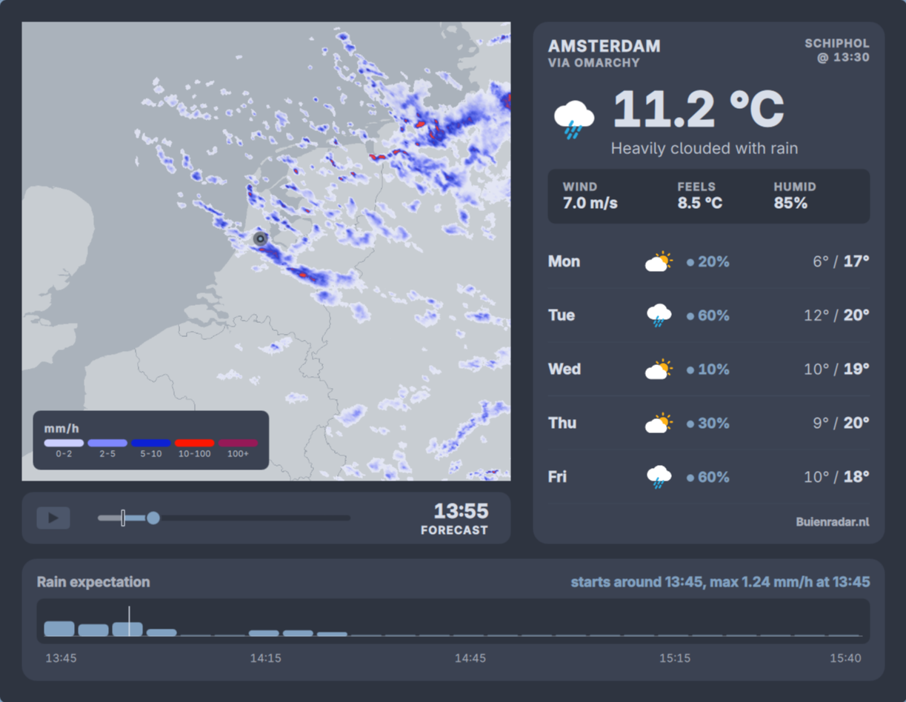

# AllesBuien

Dutch weather and rain radar for Omarchy.

AllesBuien is a native weather app for the Omarchy desktop. It combines current Dutch conditions, a five-day forecast, the rain expected over the next two hours in five-minute steps, animated radar frames, rain-soon desktop notifications, and live Omarchy theme integration in one Qt Quick window.



Weather data and radar imagery: [Buienradar.nl](https://www.buienradar.nl)

> AllesBuien is an independent project, not affiliated with or endorsed by Buienradar. It uses Buienradar's free weather data under its [terms](https://www.buienradar.nl/overbuienradar/gratis-weerdata): non-commercial use, with Buienradar.nl named and linked, as above and in the app.

## Install

AllesBuien is two pieces: the native application, and an Omarchy bar widget that opens it. You need Omarchy 4 on x86_64, fully updated with `omarchy-update`. Each release is built against the Qt in Arch's repositories on the day it is made, and needs at least that Qt. Omarchy's default stable channel ships a new Qt version later than Arch does, and until it has, the widget's click says it needs a newer Qt and installs nothing; a later Qt can stop a release too, as [Updating](#updating) says. Omarchy also ships the `curl`, `sha256sum`, `bsdtar`, and `pacman` the widget uses. The package pulls in Qt 6 (`qt6-base` and `qt6-declarative`), and `libnotify` is optional: only rain-soon notifications need it.

Add the plugin, then let it install the app:

```bash
omarchy plugin add https://github.com/robi42/AllesBuien.git --enable
```

The widget appears in the bar's center section as a radar-screen icon, the Nerd Font glyph `nf-md-radar`. While the application is missing, the icon is dimmed, and one click opens Omarchy's floating terminal, downloads the release package that the plugin's `plugin/release.sha256` pins from this repository's [releases page](https://github.com/robi42/AllesBuien/releases), checks it against the SHA-256 digest in that file, and installs it with `sudo pacman -U` — the password prompt and pacman's own confirmation appear in that terminal — then starts the app. A download that fails or does not match the digest stops before pacman runs, and the terminal says so. A package built against a newer Qt than this machine has stops too, before the password prompt, and the terminal asks you to run `omarchy-update` and click again, which helps once Omarchy ships that Qt. Every later click focuses the open window, or launches it if none is open. A copy of the plugin that pins no release yet says so on the click and points here; build from source, below, instead.

Or install the application by hand first and add the widget afterwards. Download [`plugin/release.sha256`](plugin/release.sha256) from this repository, and the package it names from the releases page, into an empty directory, check the package against the pin, and install that package:

```bash
cd "$(mktemp -d)"
curl -fsSLO https://raw.githubusercontent.com/robi42/AllesBuien/main/plugin/release.sha256
package=$(awk '{ print $2 }' release.sha256)
curl -fsSLO "https://github.com/robi42/AllesBuien/releases/download/v$(cut -d- -f2 <<<"$package")/$package"
sha256sum -c release.sha256 && sudo pacman -U "./$package"
omarchy plugin add https://github.com/robi42/AllesBuien.git --enable
```

`sha256sum -c` has to print `OK`, and the `&&` runs pacman only if it does. Anything else means the file is not the release this repository pinned, so do not install it.

`--enable` asks which bar section to place the widget in, with the center preselected, where it goes right after Omarchy's weather pill if the pill is in the center too, and at the end of the center otherwise. To move it later:

```bash
omarchy bar move io.github.robi42.allesbuien --section right
```

The widget only opens, focuses, installs, or updates the application. The window itself, its notifications, and `omarchy-weather-location` behave exactly as they do without the widget, and the application runs perfectly well with no plugin installed at all.

## Updating

The widget installs and updates only the release its own copy pins, and a newer pin reaches it only with the plugin itself:

```bash
omarchy plugin update io.github.robi42.allesbuien
```

That shows the change as a diff and asks before applying it. Before confirming, read what the diff changes in `manifest.json` and under `plugin/`: `manifest.json` names the files the shell loads, today only `plugin/BarWidget.qml`, and a QML file can load others in turn, so a file either of them starts naming is one to read too, wherever it sits; `plugin/BarWidget.qml` decides which commands the widget runs; and `plugin/widget.sh` and `plugin/release.sha256` decide what a click installs with sudo, as [SECURITY.md](SECURITY.md) describes. Once the updated plugin pins a newer release than the installed `allesbuien` package, the icon turns the bar's urgent colour, with an "update ready" tooltip. Click it, and the same floating terminal shows the installed and the new version, downloads and checks the package, and lets pacman ask before replacing it. Updated or not, the click ends with AllesBuien open or focused. An AllesBuien that was already running keeps the old version until you restart it; the terminal says so, and nothing is closed for you.

The widget never asks GitHub for the latest release. It leaves alone any installation it does not own — an `allesbuien` binary another package provides, or a user-scope install in `~/.local/bin` ([Mode B](#mode-b-user-scope-cargo-install)) — and any `allesbuien` package already at or past the pin: those it only opens or focuses.

AllesBuien binds a few parts of Qt's private API, which Qt does not promise to keep, so a Qt newer than the one a release was built against can stop that release from starting, whether an `omarchy-update` brings that Qt later or it was there already when the click installed the release. If the window does not open, run `allesbuien` in a terminal. An error that names `Qt_6_PRIVATE_API` means the release and this machine's Qt do not match. Usually this Qt is the newer one, and the fix is a new release built against it: once that is out, `omarchy plugin update` brings its pin, and the icon's next click installs it. Until then, you can rebuild the version you have against the Qt you have: in a clone, as [Build from source](#build-from-source) describes, check out its tag (`git checkout v0.2.0` when `pacman -Q allesbuien` shows `0.2.0-1`), run `cargo clean` if that clone has built before, since Cargo does not notice that Qt changed, and build and install the package as [Mode A](#mode-a-pacman-package) does. A release installed by hand has had no Qt check, so there an error that names `Qt_6_PRIVATE_API`, or `Qt_6`, can instead mean this Qt is older than the release needs, which `omarchy-update` mends once Omarchy ships that Qt.

## Alongside the Omarchy weather widget

The launcher does not replace Omarchy's own weather pill, and it is not a clone of it: both can sit in the bar at the same time, neither disables or reorders the other, and the pill keeps its panel, its settings, and its IP auto-detection. The two read the same desktop location setting, and AllesBuien only ever reads it — `omarchy-weather-location` remains the one place that setting is changed.

The glyphs are deliberately unlike each other. The pill draws the current condition, a cloud or a sun or a raindrop; the launcher draws a radar screen, the same one in every kind of weather, so the bar never shows the same pictogram twice.

## Location

AllesBuien reads the location Omarchy already knows, so there is nothing extra to configure and no second place to change it:

```bash
omarchy-weather-location --set Groningen 53.22,6.57
omarchy-weather-location --clear
```

The open window follows either command within about two seconds. The place name, the marker on the radar, and the weather it fetches all move together; no restart is involved, and the desktop's own weather widget follows the same file at the same time.

Three sources answer in order. An `ALLESBUIEN_LAT`/`ALLESBUIEN_LON` pair, with `ALLESBUIEN_LOCATION_LABEL` to name it, pins this app alone and outranks everything after it, including later changes to the Omarchy setting. Omarchy's `~/.local/state/omarchy/settings/weather.json` decides otherwise, provided it carries a name and both coordinates. Failing both, the window falls back to Amsterdam-West. The header says which of the three answered, so a fallback reads as a default rather than as a place someone chose.

Two behaviours are deliberate, and both follow from this being a Dutch radar viewer rather than a general weather app:

Unlike Omarchy's own weather widget, **AllesBuien does not auto-detect your location from your IP address.** That widget can render any city on Earth, so detection is a good default for it. This one draws Buienradar's Dutch radar and nothing else, so an IP resolving to Berlin would produce a confident-looking window over a permanently empty map. A sensible Dutch default, captioned NO SETTING under the place name, is the better wrong answer.

And a location outside the radar's coverage says so on the map, rather than leaving a blank raster that looks like a failed download. `omarchy-weather-location --set Malibu` — a name with no coordinates — is treated as no setting at all, because geocoding it would mean owning a copy of a setting the desktop already owns.

## Notifications

When rain is expected to start within 30 minutes, AllesBuien announces it through `notify-send`, which `libnotify` provides, once for each spell of rain: later refreshes stay quiet while that rain is on its way or falling, however its expected start or strength changes. The spell is over when a refresh finds the next two hours dry or, from an hour after the announcement on, finds the rain more than 30 minutes away; the next rain within 30 minutes is then announced again, and so is rain at any place the window moves to. Three environment variables, read when the app starts, tune this:

- `ALLESBUIEN_NOTIFY`: notifications are on unless this is set to something other than `1`, `true`, `yes`, or `on`.
- `ALLESBUIEN_NOTIFY_THRESHOLD_MIN`: how many minutes ahead rain counts as news, 30 by default.
- `ALLESBUIEN_NOTIFY_COOLDOWN_MIN`: the shortest time, in minutes, that an announced spell stays open while rain is still in the forecast, 60 by default.

## Privacy

AllesBuien has no account, no telemetry, and no server of its own. While its window is open it asks Buienradar for weather, and sends nothing anywhere else:

- every 10 minutes, and whenever the location changes, the national feed from `data.buienradar.nl` and the two-hour rain expectation for your location from `gpsgadget.buienradar.nl`, which receives your latitude and longitude to four decimal places, about 11 metres;
- every 5 minutes, the national radar frames from `image.buienradar.nl`, which serves them from `image-cdn.buienradar.nl`;
- the condition icons from `cdn.buienradar.nl`, each fetched once and then kept under `~/.cache/allesbuien`.

Like any web request, these carry your IP address, and the app names itself in them as `allesbuien/<version>`. The bar widget contacts GitHub only when a click installs or updates the app, to download the pinned package from this repository's releases.

## Keys

- **Space** or **Enter** plays and pauses the radar, wherever the focus is.
- **Left** and **Right** step one frame back or forward and pause.
- **Home** and **End** jump to the first and the last frame; the animation ends where the rain graph below the map does.
- **Tab** moves between the play button and the timeline, which show a ring while they have keyboard focus.
- **Escape** closes the window.

## Optional Hyprland wiring

Nothing above touches your Hyprland configuration. If you want a keybinding and a floating window, add these two lines to `~/.config/hypr/bindings.lua` yourself, then reload:

```lua
o.bind("SUPER + ALT + W", "AllesBuien", { launch = "allesbuien", focus = "^allesbuien$" })
o.window("allesbuien", { float = true })
```

```bash
hyprctl reload
```

Without the second line the window tiles like any other, which is fine; the app does not depend on either line.

## Build from source

Building needs Rust 1.98.0, which `mise install` provides, and `qt6-base` and `qt6-declarative`, which on Arch include the development headers. If you only want to build, rustup is enough: `rust-toolchain.toml` selects 1.98.0. `mise install` also trusts the checkout's `mise.toml` and installs the pre-commit hook described under [Development](#development). Mode A also needs Arch's `makepkg`, [`just`](https://github.com/casey/just), and a pacman package that provides `rust`, such as `rustup` (`sudo pacman -S just rustup`). makepkg checks the PKGBUILD's build dependencies against pacman's database, which knows nothing of mise's toolchain; the build itself still uses Cargo 1.98.0, the only version `bin/build` accepts. Clone the repository and run every command from its root:

```bash
git clone https://github.com/robi42/AllesBuien.git && cd AllesBuien
mise install
```

### Mode A: pacman package

At your own terminal, where sudo can ask for your password:

```bash
just package
just install
```

`just install` installs the package `just package` built. It refuses while a Mode B install is in `~/.local/bin`, which comes first on `PATH` and would hide the package; remove that one first, as [Uninstall](#uninstall) says.

Unattended, use this only when passwordless sudo is already authorised for the exact pacman install and removal commands. `bin/install` builds the release binary and runs the one canonical package command, `(cd pkgbuild && makepkg -f)`. It installs nothing and never prompts for privilege, and the command it prints at the end is [Mode B](#mode-b-user-scope-cargo-install)'s, not a step of this route.

```bash
bin/install
sudo -n /usr/bin/pacman -U --noconfirm "$(pwd)/pkgbuild/allesbuien-0.2.0-1-x86_64.pkg.tar.zst"
```

Remove the package again with the matching non-interactive command:

```bash
sudo -n /usr/bin/pacman -Rns --noconfirm allesbuien
```

Do not use the unattended form if either command would ask for a password. Either way, build with `makepkg -f` alone, as `just package` and `bin/install` do: installing is the separate step above, not `makepkg -i`.

### Mode B: user-scope Cargo install

This mode needs no root privileges. It installs the binary under `~/.local/bin` and the desktop entry, icon, and licence under one XDG data root:

```bash
DATA_HOME="${XDG_DATA_HOME:-$HOME/.local/share}"
cargo install --locked --root ~/.local --path app
install -Dm644 pkgbuild/allesbuien.desktop "$DATA_HOME/applications/allesbuien.desktop"
install -Dm644 pkgbuild/allesbuien.svg "$DATA_HOME/icons/hicolor/scalable/apps/allesbuien.svg"
install -Dm644 LICENSE "$DATA_HOME/licenses/allesbuien/LICENSE"
```

`--locked` builds the dependency versions `Cargo.lock` records, the ones CI tested; without it, `cargo install` resolves them afresh.

## Uninstall

Remove the widget first, then the application, in this order:

```bash
omarchy plugin remove io.github.robi42.allesbuien
```

For the package the widget's click installs, or one built from this repository with Mode A:

```bash
sudo pacman -Rns allesbuien
```

For Mode B, uninstall the Cargo binary and remove all user payloads from the same resolved XDG data directory:

```bash
DATA_HOME="${XDG_DATA_HOME:-$HOME/.local/share}"
cargo uninstall --root ~/.local allesbuien
rm -f "$HOME/.local/bin/allesbuien" \
  "$DATA_HOME/applications/allesbuien.desktop" \
  "$DATA_HOME/icons/hicolor/scalable/apps/allesbuien.svg"
rm -rf "$DATA_HOME/licenses/allesbuien"
```

However it was installed, AllesBuien keeps radar frames, condition icons, and Qt's shader caches per user, and none of the commands above removes them; this does:

```bash
rm -rf "${XDG_STATE_HOME:-$HOME/.local/state}/allesbuien" "${XDG_CACHE_HOME:-$HOME/.cache}/allesbuien"
```

Finally, only if you added the optional Hyprland wiring above, delete those two lines from `~/.config/hypr/bindings.lua` and run `hyprctl reload`.

## Dependencies

- For the widget: the application itself, either the release package its click installs or a build from this repository.
- `qt6-base` and `qt6-declarative`, which the package pulls in; a release needs at least the Qt it was built against, as [Install](#install) says, and a later Qt can still stop it, as [Updating](#updating) says.
- `libnotify`, optional; without it the app runs and simply never notifies.
- Omarchy itself, which ships `curl`, `sha256sum`, `bsdtar`, and `pacman` for the widget's install and update click, and `hyprctl` plus `jq` for `omarchy-launch-or-focus`. No AUR helper is needed.
- Network access to Buienradar for observations, forecasts, and radar frames.

## Development

`bin/test` is the repository's complete quality gate, and the one CI runs on every pull request. It takes over twenty minutes from cold, because CXX-Qt regenerates C++, and leaves a few gigabytes under `target/`; [CONTRIBUTING.md](CONTRIBUTING.md) describes the faster loop for working on one change. To run it, install the pinned tools and the pre-commit hook first:

```bash
mise install
bin/test
```

`mise install` provides Rust 1.98.0 with its rustfmt, clippy, and llvm-tools components, cargo-llvm-cov at the version `.llvm-cov-version` names, cargo-about at the version `.cargo-about-version` names, actionlint, shellcheck, and lefthook 2.1.16, then, in the main checkout, runs `lefthook install`, which writes the pre-commit hook into `.git/hooks`, where every worktree shares it. In a linked worktree `mise install` leaves the hook alone, but `lefthook install` run by hand in one still rewrites the hook every worktree shares from that worktree's `lefthook.yml`. The hook runs `cargo fmt --all --check` and `bin/check-fast` before each commit. A commit fails when the hook finds no lefthook, or first finds one older than 2.1.16. The hook never reinstalls itself, so after a change to `lefthook.yml` beyond its jobs, such as a new hook, run `mise install` in the main checkout again. Because `mise.toml` sets up that hook, mise reads it only from a trusted checkout: `mise install` trusts the one it runs in, and a linked worktree shares its main checkout's trust.

The coverage tools are pinned in `mise.toml` too, which needs mise 2026.7.4 or later to install the toolchain's components. mise exports `RUSTUP_TOOLCHAIN` from its Rust pin, which outranks `rust-toolchain.toml` and the components listed there, so a toolchain that mise set up lacks a component until `mise install` adds it. Run it again after a change to `mise.toml`'s tools: the gates never install a missing tool themselves, they fail and say to run `mise install`. CI installs the cargo-llvm-cov that `.llvm-cov-version` names and the cargo-about that `.cargo-about-version` names, and `bin/test` holds `mise.toml`'s pins to them, so a bump of either changes both files and, like a Rust or lefthook bump, puts a `mise.toml` diff in front of a human reader.

Build the release application with:

```bash
bin/build
```

[`just`](https://github.com/casey/just) lists shortcuts over these for people: `just ci` runs `bin/test`, `just check` runs `bin/check-fast`, `just run` starts the app from the checkout, and `just package` and `just install` are Mode A above. Nothing in the gate runs them, so `just` is not among the tools `mise.toml` pins.

Among other gates, `bin/test` checks the per-file module-size budget, rustfmt, Clippy with warnings denied, ShellCheck and actionlint, the offscreen Qt workspace tests and their re-run in four time zones, the zero-CXX core dependency seam, at least 90% line coverage for `allesbuien-core`, the pinned `cargo-llvm-cov` and `cargo-about` versions, the third-party notices the package ships against `Cargo.lock` and the headers of the crates the binary links, Qt 6 QML lint and the QML type contract, the bar widget's install and update script against fake `pacman`, `curl`, and `sha256sum`, and finally that every gate with known-bad inputs under `tests/gates/` still fails on them; `tests/gates/README.md` names the four expensive gates that have none, and why.

Bugs and ideas are welcome as [GitHub issues](https://github.com/robi42/AllesBuien/issues), and pull requests as [CONTRIBUTING.md](CONTRIBUTING.md) describes; a security problem goes privately, as [SECURITY.md](SECURITY.md) says. The maintainer also keeps a backlog in [beads](https://github.com/gastownhall/beads) for their own agent pipeline. Its database lives in a private repository, robi42/AllesBuien-beads, so a clone carries only its configuration, `.beads/`, and you do not need it to contribute. That pipeline, the software factory, is not part of this repository either: its only footprint here is the two files below, `.factory/gate`, which runs `bin/test`, and `.factory/protected`.

`.factory/gate` is the software factory's definition of done and wraps `bin/test`, so an agent-driven branch is held to the same gate CI runs. `.factory/protected` lists the paths whose diffs a human has to read before that branch can land: the gate's scripts, the fixture allowlist, the workflows and `deny.toml`, `pkgbuild/about.toml` and `pkgbuild/about.hbs`, whose accepted licences and hand-kept notices no gate can judge, the justfile, whose `just install` runs sudo, and mise's and lefthook's config files, which steer the pre-commit hook every worktree shares, with the root `.gitignore`, whose re-includes keep a global ignore from hiding a local one. A branch that drops `no_auto_install` or the postinstall's guard, or adds a `lefthook-local` file that turns `no_auto_install` off, has rewritten that hook at its first commit or `mise install` in its worktree, before the software factory flags it; `mise install` in the main checkout writes it back.

### Third-party notices

The binary compiles in code AllesBuien does not own: the crates it is built from, the Rust standard library, and code from the Qt headers. `pkgbuild/THIRD-PARTY-LICENSES` carries the notices their licences ask a copy of the binary to travel with, and the package installs it in `/usr/share/licenses/allesbuien/`, beside `LICENSE` and the building toolchain's `COPYRIGHT-library.html`, the standard library's own. cargo-about writes the file from `Cargo.lock` with `pkgbuild/about.toml` and `pkgbuild/about.hbs`. It is committed and never edited by hand; after a change to any of the three, regenerate it from the repository root and commit the result:

```bash
cargo fetch --locked && cargo about generate --frozen --fail -m app/Cargo.toml -c pkgbuild/about.toml -o pkgbuild/THIRD-PARTY-LICENSES pkgbuild/about.hbs
```

Without mise, `cargo install --locked --features cli cargo-about@"$(cat .cargo-about-version)"` builds the cargo-about this needs; without `--features cli`, that command succeeds and installs nothing.

`bin/test` regenerates the file the same way and refuses any difference, so a Dependabot pull request that adds, drops, or relicenses a crate, or changes a licence file, goes red until the file follows. The template prints no versions, so a bump that does neither leaves the file as it is. Regenerate it on that pull request's branch and push it in one push with the `cargo update -p cxx-gen --precise` fix that `bin/check-fast` asks for when a cxx bump leaves cxx-gen behind, if it does, and leave `[dependabot skip]` out of the commit message: with it, Dependabot's next rebase would force-push over the commit.

`about.toml`'s `accepted` list is the licence policy. A crate is listed under the first of its licences the list allows, and a crate that allows none of them stops the generation by name, so accepting a licence there is the decision to redistribute code under it. `about.hbs` writes the preamble and keeps, by hand, the notices that sit in source files' headers rather than in a crate's licence files, which are all cargo-about reads. `bin/test` reads those headers in every crate the binary links, and refuses a copyright holder the notices name on no `Copyright` line, a BSD-style header whose text they do not reproduce, and a linked crate their index leaves out. A refused licence is a decision for `about.toml`; a new holder or header goes into `about.hbs`'s hand-kept section; either way, regenerate afterwards. Both files are listed in `.factory/protected`, because the gates prove that the notices match them, not that they are right.

### Plugin checks

`bin/test` proves the widget's shell half, `plugin/widget.sh`, and the committed pin, against fake `pacman`, `curl`, and `sha256sum` in its workspace tests, and holds only a text belt over the rest — the manifest's shape, entry points that are tracked files, no symlink anywhere, no literal colour — because CI runs in a bare Arch container, and `qs.Ui`, `omarchy-plugin-validate`, and the shell itself exist only on an Omarchy desktop. Run these three checks by hand before every tag, and again on the pin commit that follows it.

Which states a checked commit can show depends on its pin. With no pin at all, as before the first release's pin commit, an absent application gets the message pointing to *Install* and an installed one is launched or focused. Once a release is pinned, the click also installs it, and an older package shows update ready; between a later version bump and its pin commit, the pin still names the previous release.

Validate what `omarchy plugin add` would clone: a clean checkout of `main` from GitHub, because the validator walks ignored `target/` too and refuses every symlink it finds, and because the commit these checks pass on is the one a release tags. The `rev-parse` line prints it; note it down for the tag:

```bash
rm -rf /tmp/allesbuien-candidate
git clone -q https://github.com/robi42/AllesBuien.git /tmp/allesbuien-candidate
git -C /tmp/allesbuien-candidate rev-parse HEAD
omarchy plugin validate /tmp/allesbuien-candidate
```

Keep the clone until the end: the click-through below installs it, and it is deleted only after the widget has been removed again.

Lint the widget. `qs.Ui` resolves through a module root named `qs`, so the shell directory has to be reachable under that name:

```bash
mkdir -p /tmp/qmlroot && ln -sfn /usr/share/omarchy/shell /tmp/qmlroot/qs
/usr/lib/qt6/bin/qmllint -I /tmp/qmlroot /tmp/allesbuien-candidate/plugin/BarWidget.qml
```

One warning is expected, and Omarchy's own bar widgets produce it too: `bar.run` is not visible on the `QtObject` the bar is declared as. Omarchy 4.0.4 and earlier add a second, also expected: `QProcess::ExitStatus` has no QML type for `onExited`'s second parameter.

Then install the candidate and try it in a real bar:

```bash
omarchy plugin add /tmp/allesbuien-candidate --enable
```

Before clicking anything, make the install step inert. A click while the application is absent, or while an update is ready, runs `sudo -v` and `sudo pacman -U`, which ask for a password and install a package; proving the press path does not need that, and the real install click belongs to whoever is publishing the release. Edit the copy the shell actually loads — `omarchy plugin add` clones the candidate, so editing the candidate changes nothing now, and an uncommitted edit there would never have been cloned in the first place:

```bash
widget=~/.config/omarchy/plugins/io.github.robi42.allesbuien/plugin/widget.sh
sed -i 's/sudo -v/echo dry-run sudo -v/; s/sudo pacman -U/echo dry-run pacman -U/' "$widget"
grep -c 'echo dry-run' "$widget"   # 3: the password prompt, the install, and the update
```

The widget runs the script afresh on every probe and click, so the edit takes effect at once. An edited installed copy also misleads `omarchy plugin update`. An update that changes a file edited there cannot fast-forward it. Any other, such as a pin commit while only `plugin/widget.sh` is edited, fast-forwards it and keeps the dry run, so its click would still never install, unless the update then fails Omarchy's validation: the `git reset --hard` that rolls it back takes the dry run with it. That is one more reason these checks end by removing the plugin.

Now click the icon and watch the states: dimmed while the application is absent, with the install tooltip while a release is pinned and one pointing to *Install* while none is, and a click opening the floating terminal, which with a pin downloads, checks, and echoes the dry run instead of installing, and without one says nothing is pinned yet; while the repository is private the download fails, and the terminal says so and installs nothing. Then: lit within five seconds of an install finishing elsewhere (`cargo install --locked --root ~/.local --path app` is enough); launching the window when none is open; focusing the open window instead of opening a second one. None of these may need a shell restart or a plugin reload. Check the last two with another window open whose title mentions AllesBuien — this repository's GitHub page, as the browser's active tab, will do, but not a window titled exactly AllesBuien, which is the application's own title: the click has to launch or focus the application itself, never that window.

On a pin commit, check update ready too. It needs an `allesbuien` package older than the pin to own the binary PATH finds, so in your own terminal install v0.1.0's package and move the Mode B binary aside, since `~/.local/bin` comes before `/usr/bin` on the login PATH and an unowned binary must keep launching rather than being updated:

```bash
cd "$(mktemp -d)"
gh release download v0.1.0 --repo robi42/AllesBuien --pattern 'allesbuien-0.1.0-*'
sudo pacman -U ./allesbuien-0.1.0-*.pkg.tar.zst
mv ~/.local/bin/allesbuien ~/.local/bin/allesbuien.mode-b
omarchy-shell shell rescanPlugins
```

The rescan recreates the widget, and its first probe turns the icon the bar's urgent colour with the update tooltip. A click shows `0.1.0-1` and the pinned version, downloads, checks, echoes the dry run instead of running pacman, and opens or focuses AllesBuien. While the repository is private that download fails: the terminal says so, installs nothing, and still opens the installed version. That is the failure check, and naming `9.9.9-1` in the installed copy's `release.sha256` reproduces it at any time; the successful half belongs to the dry run once the repository is public.

Finish by putting the desktop back as it was, the last two lines only if you ran the update-ready check:

```bash
omarchy plugin remove io.github.robi42.allesbuien
rm -rf /tmp/allesbuien-candidate
sudo pacman -Rns allesbuien
mv ~/.local/bin/allesbuien.mode-b ~/.local/bin/allesbuien
```

### Releasing

Nine files carry the version and `release.yml` compares only three of them against the tag, so bump all nine; `bin/check-fast`'s `release version` gate refuses a commit that leaves one behind: `app/Cargo.toml`, `core/Cargo.toml`, `app/harness/Cargo.toml`, `app/testkit/Cargo.toml`, `assets/gen-basemap/Cargo.toml`, the five versioned workspace entries in `Cargo.lock` (`cargo update --workspace --offline`), `pkgver=` in `pkgbuild/PKGBUILD`, `"version"` in `manifest.json`, and the package filename in this README.

Land everything else first: when the marketplace scans `main`, its head has to be the pin commit, or a later commit that meets the condition given for submitting at the end of this section, and anything pushed to `main` after the listing shows as an unverified update until it is verified again. Then write the release's `CHANGELOG.md` section, dated the day you tag, and land it on `main`. Once CI is green there, run the plugin checks above, which print the commit they checked. Before tagging, enable GitHub's immutable releases for the repository, so a published release's tag and assets can never change under a pin.

Tag the checked commit, not whatever happens to be checked out locally, with the section as the message under a first line naming the release, the way `v0.1.0`'s message begins, and sign the tag: `git tag -s` signs with the key `user.signingkey` names, here the SSH key registered on GitHub as a signing key, so GitHub shows the tag as verified:

```bash
git fetch origin
sha=$(git rev-parse origin/main)   # must be the commit the plugin checks printed
version=$(git show "$sha:app/Cargo.toml" | sed -n 's/^version = "\(.*\)"/\1/p' | head -1)
{ printf 'AllesBuien %s\n\n' "$version"
  git show "$sha:CHANGELOG.md" | awk -v h="## [$version]" 'index($0, h) == 1 { f = 1; next } /^## \[/ { f = 0 } f'
} > "/tmp/allesbuien-v$version.md"
git tag -s "v$version" --cleanup=whitespace -F "/tmp/allesbuien-v$version.md" "$sha" &&
  git cat-file -p "v$version"
git cat-file -p "v$version" | grep -c 'BEGIN SSH SIGNATURE'   # 1: the tag is signed
```

`--cleanup=whitespace` is what keeps the section's `###` headings: git's default cleanup takes every line starting with `#` for a comment and deletes it. Before pushing, check that `git cat-file -p` printed the section with its headings, on its `object` line the commit the plugin checks printed, and at its end an SSH signature, which the last line counts: it has to print `1`. The pushed tag is what builds the release, and once the release is published, the tag can never move. If anything is wrong, or `git tag` says the tag already exists because an earlier attempt left it behind, do not push: delete it with `git tag -d "v$version"`, put right what was wrong, and run the block above again. To have git sign every tag made in this checkout, a `git tag -a` included, set `git config tag.gpgSign true` once. Then, in the same terminal, push the tag:

```bash
git push origin "refs/tags/v$version"
```

The push runs `release.yml`. Its build job checks the tag against its three version surfaces and builds the package, with a token that can only read; its publish job, which alone can write and runs none of the build's code, makes the source archive and leaves a draft release holding both. Nothing about a draft is final yet. Re-running the whole workflow rebuilds the package and replaces the draft's assets; re-running only a failed publish job should upload the package the build job already made, for the seven days its artifact is kept, though GitHub does not document that a re-run can read an earlier attempt's artifact. `gh release delete "v$version" --repo robi42/AllesBuien --cleanup-tag` deletes the draft along with the pushed tag, after which `git tag -d "v$version"` and the tag block above start the release again. A run that stopped before it made a draft leaves only the pushed tag, which `gh release delete` leaves alone, since it stops at `release not found`; delete that tag with `git push origin --delete "refs/tags/v$version"` instead. Once the run is green, inspect the draft. These steps read `version` as the tag block set it and run from the repository root; in a new terminal, set `version` again first:

```bash
gh release view "v$version" --repo robi42/AllesBuien --json isDraft,assets --jq '.isDraft, .assets[].name'
d=$(mktemp -d)
gh release download "v$version" --repo robi42/AllesBuien --dir "$d" --pattern "allesbuien-$version-*-x86_64.pkg.tar.zst"
bsdtar -tf "$d"/allesbuien-"$version"-*-x86_64.pkg.tar.zst
```

The first command has to print `true` and then exactly two assets: the package, `allesbuien-<version>-<pkgrel>-x86_64.pkg.tar.zst`, and the source archive, `allesbuien-v<version>-src.tar.gz`, with no `allesbuien-debug-…` package beside them. The last lists the package's files: `usr/bin/allesbuien`, the desktop entry, the icon, and under `usr/share/licenses/allesbuien/` the licence texts the PKGBUILD installs. The workflow leaves the release's description empty, and GitHub would then show the tag message as preformatted text, so give the draft the same notes as Markdown, read back from the tag itself. A release's notes break at every newline, so `awk` first joins each bullet's wrapped lines into one:

```bash
git tag -l --format='%(contents:body)' "v$version" |
  awk '/^  [^ ]/ { sub(/^  /, " "); buf = buf $0; next } { if (n++) print buf; buf = $0 } END { if (n) print buf }' |
  gh release edit "v$version" --repo robi42/AllesBuien --notes-file -
```

Before publishing, install and start the draft's package once, since nothing else runs these bytes: the click-through only dry-runs the install, and CI tests a build of its own, not the package makepkg made for the release. A draft that fails can still be deleted and released again under the same version, as above; a published release cannot. At your own terminal, where sudo can ask for your password, from the repository root, download the package, move a Mode B install aside, since `~/.local/bin` comes before `/usr/bin` on `PATH` and whatever starts the app would find that one first, and install the package if it matches the digest GitHub records for it:

```bash
d=$(mktemp -d)
package=allesbuien-$version-$(sed -n 's/^pkgrel=//p' pkgbuild/PKGBUILD)-x86_64.pkg.tar.zst
digest=$(gh release view "v$version" --repo robi42/AllesBuien --json assets --jq ".assets[] | select(.name == \"$package\") | .digest")
echo "$digest"
gh release download "v$version" --repo robi42/AllesBuien --dir "$d" --pattern "$package"
[ -e ~/.local/bin/allesbuien ] && mv ~/.local/bin/allesbuien ~/.local/bin/allesbuien.mode-b
printf '%s  %s\n' "${digest#sha256:}" "$d/$package" | sha256sum --check --strict && sudo pacman -U "$d/$package"
```

`echo` shows the digest of the bytes under test; note it, because the pin has to name the same one. `sha256sum` has to print `OK`, and the `&&` runs pacman only if it does. Then start the package's binary from the same terminal, so anything it reports shows there:

```bash
/usr/bin/allesbuien
```

The window has to open and fill in: the current conditions, the forecast, the rain graph, and a radar that plays. Switch to another Omarchy theme and watch the window follow it within about two seconds, then switch back. Note down the private Qt API symbols the binary binds, too: a Qt update that drops one of them stops every installed copy from starting, and only a new release mends that.

```bash
objdump -T /usr/bin/allesbuien | grep Qt_6_PRIVATE_API
```

Then close the window, remove the package, and put a Mode B install back:

```bash
sudo pacman -Rns allesbuien
[ -e ~/.local/bin/allesbuien.mode-b ] && mv ~/.local/bin/allesbuien.mode-b ~/.local/bin/allesbuien
```

If the package fails any of this, do not publish it: delete the draft and its tag as above, put right what was wrong, and release the same version again. Otherwise read the draft's page once more, `gh release view "v$version" --repo robi42/AllesBuien --web`, then publish it. This is the step that cannot be undone: from here on the tag and the assets are locked, and deleting the release would retire the tag's name for good.

```bash
gh release edit "v$version" --repo robi42/AllesBuien --draft=false
```

Check that the published release is immutable, and that GitHub attests it:

```bash
gh api "repos/robi42/AllesBuien/releases/tags/v$version" --jq '{draft, immutable}'
gh release verify "v$version" --repo robi42/AllesBuien
```

The first has to print `"draft":false` and `"immutable":true`. A release published while immutable releases were off says `false` there and must not be pinned; `bin/pin-release` refuses it. `gh release verify` checks the attestation GitHub signs as it publishes an immutable release, which names the tag and records the digests of its assets and of the tag's git object, the one that names the commit. GitHub does not document whether it makes one while a repository is private, but releases published from private repositories have so far received one. `gh` prints `no attestations for tag` whenever its lookup of the attestation fails, a lookup made too early and one refused because the API quota ran out included, so before concluding there is none, check that `gh api rate_limit --jq .resources.core.remaining` prints more than zero, wait a few minutes, and run it again. If it still finds none, decide whether to pin the release anyway, and if you do, claim no attestation for it anywhere.

Once the published release has passed these checks, pin it. From the repository root, on an up-to-date `main`:

```bash
bin/pin-release
```

It refuses a release that is still a draft or is not immutable. It reads the digest GitHub records for this version's package, downloads the package through `gh`, which is authenticated and so works while the repository is private, checks the download with `sha256sum -c`, and only then writes `plugin/release.sha256` and prints the commit to make. Read the line it wrote: its digest has to be the one the smoke test showed. If it is not, the workflow ran again after the smoke test and the published package is a rebuild nobody has started, so run the smoke test on it before going on. Then commit the line as printed, and push. That commit, or a later one that meets the condition for submitting below, is what the marketplace scans. `omarchy plugin add` and `omarchy plugin update` install whatever `main` holds when they run, so every later commit on `main` reaches users at their next update. Do not re-run the release workflow now: GitHub refuses to replace an immutable release's assets, so the run can only fail.

Then run the plugin checks again on `main`, which now carries the pin, the click-through's install and update-ready states included. If the repository is still private, make it public now, since the widget's own download is anonymous, and repeat the click-through's dry run so the real download succeeds and verifies.

Submit while the head of `main` is the pin commit, or a later commit that leaves `manifest.json`, `plugin/` and the root `.gitattributes` as the pin commit left them and passes `omarchy plugin validate` on a fresh clone. A first listing takes no commit: the marketplace scans whatever `main` holds when its issue, filed from the [submission form](https://github.com/omacom/omarchy-plugin-marketplace/issues/new?template=submit-plugin.yml), is opened or edited, scans it again at approval, and refuses to approve if `main` has moved since. So push and merge nothing to `main` until the listing is approved; if something has to land meanwhile, edit the issue, which scans the new head, and ask for a new review. For a later release, file the marketplace's "Verify or update a listed plugin" issue with "Verify and publish a newer upstream commit" and the full SHA of `main`'s head, the only commit that action accepts; it checks the head again at approval, so here too push and merge nothing to `main` until the update is approved. Until it is verified, the listing shows "Update unverified". "Verify the currently listed snapshot" accepts only the SHA already listed.

Publishing `allesbuien-bin` to the AUR comes later, as an additional channel, once AUR account registration reopens; the widget does not depend on it.

## Data and basemap licensing

AllesBuien uses Buienradar's free weather data under its [terms](https://www.buienradar.nl/overbuienradar/gratis-weerdata), which list the JSON feed, the two-hour rain expectation, and radar images to embed in a web page among the free data, but not three of the endpoints the app reads: the sprite metadata API on `image.buienradar.nl` that names the radar frames; the frames themselves, transparent 1058×915 images larger than any radar image the terms offer; and the condition icons the feed links to on `cdn.buienradar.nl`. The app uses those on the same terms, non-commercially and with the attribution. For the rain expectation, the terms give the address `gps.buienradar.nl/getrr.php` and ask that it be used rather than the address behind it. The app reads `gpsgadget.buienradar.nl`, which was that address for years, until at least 2023, though getrr.php now forwards to `gadgets.buienradar.nl`. Condition icons and radar frames are Buienradar's: the app fetches them at run time, and this repository ships none, except in the screenshot `preview.png`, which is shown with the same attribution.

- Weather observations, forecasts, and radar: **Buienradar.nl**. Free-data use requires attribution and is limited to non-commercial use. The required attribution is visible in the app and this README.
- Basemap: **Natural Earth 1:10m vector data**, public domain. Natural Earth permits use, modification, redistribution, and commercial use without required credit.
- The exact Natural Earth commit, source URLs, terms link, and generated basemap SHA-256 are recorded in [`assets/BASEMAP-LICENSE`](assets/BASEMAP-LICENSE).
- Application code: [MIT License](LICENSE).
- Third-party code: the licences and copyright notices of the Rust crates compiled into the binary are in [`pkgbuild/THIRD-PARTY-LICENSES`](pkgbuild/THIRD-PARTY-LICENSES), which the package installs in `/usr/share/licenses/allesbuien/` beside `LICENSE` and the Rust standard library's `COPYRIGHT-library.html`. Qt, which the app links dynamically, is used under the LGPL-3.0, whose text `qt6-base` and `qt6-declarative` install.
