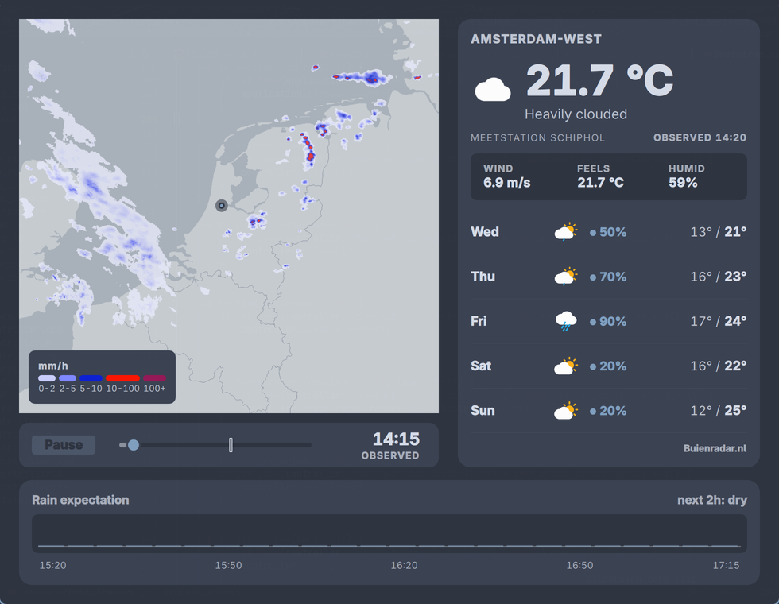

# AllesBuien

Dutch weather and rain radar for Omarchy.

AllesBuien is a native weather app for the Omarchy desktop. It combines current Dutch conditions, a five-day forecast, minute-resolution rain expectations, animated radar frames, rain-soon desktop notifications, and live Omarchy theme integration in a floating Qt Quick window.



[Buienradar.nl](https://www.buienradar.nl)

> Buienradar's free weather data is available for non-commercial use with attribution. AllesBuien is intended for personal, non-commercial use.

## Install

AllesBuien is two pieces: the native application, and an Omarchy bar widget that opens it. You need Omarchy (which ships `yay` and the plugin commands) and Qt 6 — `qt6-base` and `qt6-declarative`, both pulled in by the package. `libnotify` is optional and only rain-soon notifications need it.

Add the plugin, then let it install the app:

```bash
omarchy plugin add https://github.com/robi42/AllesBuien.git --enable
```

The widget appears in the bar's center section as a `󰐷` radar dish. While the application is missing the icon is dimmed, and one click opens Omarchy's floating terminal, installs `allesbuien-bin` from the AUR — the sudo password prompt appears in that terminal — and starts the app. Every later click focuses the open window, or launches it if none is open.

Or install the application first and add the widget afterwards:

```bash
yay -S allesbuien-bin
omarchy plugin add https://github.com/robi42/AllesBuien.git --enable
```

Without the AUR, download `allesbuien-0.2.0-1-x86_64.pkg.tar.zst` from the [releases page](https://github.com/robi42/AllesBuien/releases) and install it directly:

```bash
sudo pacman -U ./allesbuien-0.2.0-1-x86_64.pkg.tar.zst
```

`--enable` asks which bar section to place the widget in, with the center preselected. To skip the question, or to move the widget later:

```bash
omarchy plugin enable io.github.robi42.allesbuien --after omarchy.weather
omarchy bar move io.github.robi42.allesbuien --section right
```

The widget only opens, focuses, or installs the application. The window itself, its notifications, and `omarchy-weather-location` behave exactly as they do without the widget, and the application runs perfectly well with no plugin installed at all.

## Alongside the Omarchy weather widget

The launcher does not replace Omarchy's own weather pill, and it is not a clone of it: both can sit in the bar at the same time, neither disables or reorders the other, and the pill keeps its panel, its settings, and its IP auto-detection. The two read the same desktop location setting, and AllesBuien only ever reads it — `omarchy-weather-location` remains the one place that setting is changed.

The glyphs are deliberately unlike each other. The pill draws the current condition, a cloud or a sun or a raindrop; the launcher draws a radar dish, the same one in every kind of weather, so the bar never shows the same pictogram twice.

## Location

AllesBuien reads the location Omarchy already knows, so there is nothing extra to configure and no second place to change it:

```bash
omarchy-weather-location --set Groningen 53.22,6.57
omarchy-weather-location --clear
```

The open window follows either command within about two seconds. The place name, the marker on the radar, and the weather it fetches all move together; no restart is involved, and the desktop's own weather widget follows the same file at the same time.

Three sources answer in order. An `ALLESBUIEN_LAT`/`ALLESBUIEN_LON` pair pins this app alone and outranks everything after it, including later changes to the Omarchy setting. Omarchy's `~/.local/state/omarchy/settings/weather.json` decides otherwise, provided it carries both coordinates. Failing both, the window falls back to Amsterdam-West. The header says which of the three answered, so a fallback reads as a default rather than as a place someone chose.

Two behaviours are deliberate, and both follow from this being a Dutch radar viewer rather than a general weather app:

Unlike Omarchy's own weather widget, **AllesBuien does not auto-detect your location from your IP address.** That widget can render any city on Earth, so detection is a good default for it. This one draws Buienradar's Dutch radar and nothing else, so an IP resolving to Berlin would produce a confident-looking window over a permanently empty map. A sensible Dutch default, labelled as a default, is the better wrong answer.

And a location outside the radar's coverage says so on the map, rather than leaving a blank raster that looks like a failed download. `omarchy-weather-location --set Malibu` — a name with no coordinates — is treated as no setting at all, because geocoding it would mean owning a copy of a setting the desktop already owns.

## Optional Hyprland wiring

Nothing above touches your Hyprland configuration. If you want a keybinding and a floating window, add these two lines to `~/.config/hypr/bindings.lua` yourself, then reload:

```lua
o.bind("SUPER + ALT + W", "AllesBuien", { launch = "allesbuien" })
o.window("allesbuien", { float = true })
```

```bash
hyprctl reload
```

Without the second line the window tiles like any other, which is fine; the app does not depend on either line.

## Build from source

Building needs Rust 1.98.0 (`mise install` pins it), Arch's `makepkg`, and the Qt 6 Base and Declarative development packages. Run commands from the repository root.

### Mode A: pacman package

Use this only when passwordless sudo is already authorized for the exact pacman install and removal commands. `bin/install` builds the release binary and then runs the one canonical package command, `(cd pkgbuild && makepkg -f)`; it never prompts for privilege itself.

```bash
bin/install
sudo -n /usr/bin/pacman -U --noconfirm "$(pwd)/pkgbuild/allesbuien-0.2.0-1-x86_64.pkg.tar.zst"
```

Rollback the package with the matching non-interactive command:

```bash
sudo -n /usr/bin/pacman -Rns --noconfirm allesbuien
```

Do not use Mode A if either command requires a password. Never run `makepkg` with `-s` or `-i`.

### Mode B: user-scope Cargo install

This is the active mode on the current Omarchy machine. It installs the binary under `~/.local/bin` and the desktop entry, icon, and license under one XDG data root without root privileges:

```bash
DATA_HOME="${XDG_DATA_HOME:-$HOME/.local/share}"
cargo install --root ~/.local --path app
install -Dm644 pkgbuild/allesbuien.desktop "$DATA_HOME/applications/allesbuien.desktop"
install -Dm644 pkgbuild/allesbuien.svg "$DATA_HOME/icons/hicolor/scalable/apps/allesbuien.svg"
install -Dm644 LICENSE "$DATA_HOME/licenses/allesbuien/LICENSE"
update-desktop-database "$DATA_HOME/applications"
```

The last command needs `desktop-file-utils`; if it is missing, install that package and run the line again, or the launcher will not appear in menus until the next time something rebuilds the index.

## Uninstall

Remove the widget first, then the application, in this order:

```bash
omarchy plugin remove io.github.robi42.allesbuien
```

For the AUR package — which is also what the widget's click installs — or for a package built from this repository with Mode A:

```bash
sudo pacman -Rns allesbuien-bin   # or: sudo pacman -Rns allesbuien
```

For Mode B, uninstall the Cargo binary and remove all user payloads from the same resolved XDG data directory:

```bash
DATA_HOME="${XDG_DATA_HOME:-$HOME/.local/share}"
cargo uninstall --root ~/.local allesbuien
rm -f "$HOME/.local/bin/allesbuien" \
  "$DATA_HOME/applications/allesbuien.desktop" \
  "$DATA_HOME/icons/hicolor/scalable/apps/allesbuien.svg"
rm -rf "$DATA_HOME/licenses/allesbuien"
update-desktop-database "$DATA_HOME/applications"
```

Finally, only if you added the optional Hyprland wiring above, delete those two lines from `~/.config/hypr/bindings.lua` and run `hyprctl reload`.

## Dependencies

- The application: the `allesbuien-bin` AUR package, the release package, or a package built from this repository.
- `qt6-base` and `qt6-declarative`, which the package pulls in.
- `libnotify`, optional; without it the app runs and simply never notifies.
- `desktop-file-utils`, for `update-desktop-database` in the source-install and uninstall steps; the packaged install does not need it.
- Omarchy itself, which ships `yay` for the widget's install click and `hyprctl` plus `jq` for `omarchy-launch-or-focus`.
- Network access to Buienradar for observations, forecasts, and radar frames.
- Application code is [MIT](LICENSE); the weather data carries Buienradar's non-commercial attribution terms, stated above.

## Development

Install the pinned Rust toolchain and run the repository's complete quality gate:

```bash
mise install
bin/test
```

Build the release application with:

```bash
bin/build
```

`bin/test` checks the per-file module-size budget, rustfmt, Clippy with warnings denied, offscreen Qt workspace tests, the zero-CXX core dependency seam, at least 90% line coverage for `allesbuien-core`, the pinned `cargo-llvm-cov` version, and Qt 6 QML lint.

### Plugin checks

`bin/test` proves the Rust and packaging surfaces and nothing about the bar widget: CI runs in a bare Arch container, and `qs.Ui`, `omarchy-plugin-validate`, and the shell itself exist only on an Omarchy desktop. Run these by hand before every tag.

Validate what `omarchy plugin add` would clone — a clean checkout, because the validator walks ignored `target/` too and refuses every symlink it finds:

```bash
git clone -q . /tmp/allesbuien-candidate
omarchy plugin validate /tmp/allesbuien-candidate
rm -rf /tmp/allesbuien-candidate
```

Lint the widget. `qs.Ui` resolves through a module root named `qs`, so the shell directory has to be reachable under that name:

```bash
mkdir -p /tmp/qmlroot && ln -sfn /usr/share/omarchy/shell /tmp/qmlroot/qs
/usr/lib/qt6/bin/qmllint -I /tmp/qmlroot plugin/BarWidget.qml
```

Two warnings are expected, and Omarchy's own first-party plugins produce both: `bar.run` is not visible on the `QtObject` the bar is declared as, and `QProcess::ExitStatus` has no QML type for `onExited`'s second parameter.

Then add the clone as a plugin and click the icon: dimmed with the install tooltip while the application is absent, lit within five seconds of an install finishing, launching when no window is open, focusing when one is. To exercise the press path without running a package manager, swap `installCommand` in the *clone* for an inert `omarchy-launch-floating-terminal-with-presentation "echo dry-run"`; the real install click belongs to whoever is publishing the release.

### Releasing

Nine files carry the version and `release.yml` compares only three of them against the tag, so bump all nine: `app/Cargo.toml`, `core/Cargo.toml`, `app/harness/Cargo.toml`, `app/testkit/Cargo.toml`, `assets/gen-basemap/Cargo.toml`, the five workspace entries in `Cargo.lock` (`cargo update --workspace --offline`), `pkgver=` in `pkgbuild/PKGBUILD`, `"version"` in `manifest.json`, and the package filename in this README.

Then: write the release's `CHANGELOG.md` section; run the plugin checks above; `git tag -a vX.Y.Z` with that changelog section as the tag message and push the tag, which is what builds and attaches the release assets. Once the asset exists, bump `allesbuien-bin` in its AUR clone — `pkgver`, `sha256sums` from the published asset, `makepkg --printsrcinfo > .SRCINFO`, commit, push — so the widget's install click installs the new version. Finally re-verify the marketplace listing with the new HEAD SHA; it tracks the commit it was scanned at, not `main`.

Issues are tracked in-repo as [beads](https://github.com/steveyegge/beads): `bd ready` lists what is actionable, `bd show <id>` reads one.

`.factory/gate` is the software factory's definition of done and wraps `bin/test`, so an agent-driven branch is held to the same gate CI runs. `.factory/protected` lists the paths whose diffs a human has to read before that branch can land.

## Data and basemap licensing

- Weather observations, forecasts, and radar: **Buienradar.nl**. Free-data use requires attribution and is limited to non-commercial use. The required attribution is visible in the app and this README.
- Basemap: **Natural Earth 1:10m vector data**, public domain. Natural Earth permits use, modification, redistribution, and commercial use without required credit.
- The exact Natural Earth commit, source URLs, terms link, and generated basemap SHA-256 are recorded in [`assets/BASEMAP-LICENSE`](assets/BASEMAP-LICENSE).
- Application code: [MIT License](LICENSE).
